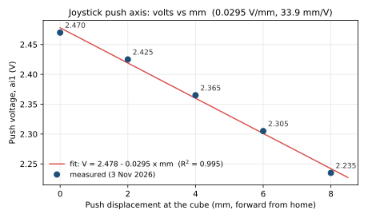

# Joystick home voltage and volts → mm

Training rig · measured 3 November 2026 (current mount) · first eyeball check 8 September 2026.
Do not trim the red joystick regulator.

## Push-axis scale (measured 3 Nov 2026, use this)

Current mount: cube on the shaft, Ledex holder, constrainer and plunger link fitted (1 Nov).
At home the cube is **2 mm** from the rest platform (the rest pad sits on the same platform).
Displacement is forward from home, at the cube.

| Push (mm) | `ai1` (V) |
| ---: | ---: |
| 0 (home) | 2.470 (approximate) |
| 2 | 2.425 |
| 4 | 2.365 |
| 6 | 2.305 |
| 8 | 2.235 |

Linear fit (least squares, all five points):

```text
V  =  2.478  −  0.0295 × mm        R² = 0.995, residuals ≤ 8 mV
mm =  (2.478 − V) × 33.9           (relative: Δmm = ΔV × 33.9, i.e. 10 mV ≈ 0.34 mm)
```



The scale is slightly steeper further out: 0.0225 V/mm from 0 to 2 mm, 0.030 from 2 to 6 mm, 0.035 from 6 to 8 mm.
Near home the fit therefore underestimates small pushes a little (from the 0–2 mm segment, 20 mV is ~0.9 mm rather than 0.68 mm).
This agrees with the 8 Sep eyeball scale (0.030 V/mm), not with the lever model in `simulations/ledex_femm` (~0.049 V/mm).
Rest drifts between sessions (2.44–2.48 V seen in October), so re-centre home boxes on the measured rest; use the slope, not the absolute volts, to convert distances.

## Axis map (confirmed 8 Sep 2026)

NI-MAX: **Voltage_1 / `Dev1/ai1` = push**. **Voltage_0 / `Dev1/ai0` = lateral**.

| Physical | Graph | DAQ | LabVIEW name | Queue index | Param-file box |
| --- | --- | --- | --- | --- | --- |
| **Push** | white | `ai1` | **Y** (`Y_POS`) | **0** | loader **X** slots: 1st and 3rd numbers |
| **Lateral** | red | `ai0` | **X** (`X_POS`) | **1** | loader **Y** slots: 2nd and 4th numbers |

`joysticklickframe_push` order is `[ai1, ai0, ai2]` = Y, X, rest pad. The param-file column was
corrected by the 09/09/26 hand test (push follows the loader's X slots; see `parameters/README.md`);
the 8 Sep analysis of the old pull file further down predates that test.

## Rest (home), 8 Sep 2026

Historical values from the first setup. Current push rest is ~2.44–2.48 V (see above); measured 1 kHz
noise with the paw on the pad is ~1 mV SD per channel, so the ±0.035 V below is the live-graph view, not
the logged noise.

| Axis | LabVIEW live graph | Rest | Noise |
| --- | --- | --- | --- |
| Push (Y, `ai1`) | white | **2.50 V** | ±0.035 V |
| Lateral (X, `ai0`) | red | **2.525 V** | ±0.035 V |

Mathis demo rest was **2.55 V**. 2.50 V is close enough; leave the regulator alone.

## Push-axis scale (provisional, 8 Sep 2026; superseded by the 3 Nov measurement above)

Pushing ~10 mm dropped the white trace from **2.50 V → 2.20 V** (Δ = 0.30 V).

| | V / mm | 10 mm |
| --- | --- | --- |
| This measurement (eyeball 10 mm) | **0.030** | 0.30 V |
| Mathis pull-task docs | 0.050 | 0.50 V |

Direction: forward push **lowers** voltage. That is the sign to use in the `end` box.

0.03 V/mm is **not** a contradiction of 0.05 V/mm. The pot reports angle; millimetres are at the contact point. A longer shaft/handle gives **fewer volts per mm**. The 10 mm mark was also by eye (at 0.05 V/mm, 0.30 V would be 6 mm). Remeasure with a ruler before writing training files.

Noise ±0.035 V is ~1 mm on this provisional scale (~0.7 mm on the old 0.05 scale). Micro-push (~0.5–1 mm) will sit near the noise floor until the scale is cleaner.

## File used on 8 Sep 2026 bench

`Full_shoterPull_Training_Task_RIG1.txt` — identical-row shorter-**pull** training file
(~1000 lines). Not a push file. One row:

```text
2.39  2  2.8  3  500  2  2  2.35  2.7  0  1.8  2.45  2.34  2.55  50  0  25  200  1000  400  0
```

| Cols | Field | This file |
| --- | --- | --- |
| 1–4 | `home` box | (2.39, 2) to (2.8, 3) — rest 2.50 / 2.525 sits inside |
| 5 | `home TO` | 500 ms (plus rest-pad gate) |
| 6–9 | `start` box | (2, 2) to (2.35, 2.7) |
| 10 | `start TO` | **0** (start wait off) |
| 11–14 | `end` box | (1.8, 2.45) to (2.34, 2.55) |
| 15 | `end TO` | 50 ms |
| 16–17 | `mag` / `magtime` | 0 / 25 |
| 18 | `watertime` | 200 ms (= 6.6 µl on this rig) |
| 19 | `timeout` (Case 0 ITI) | **1000** |
| 20 | `move time` (Case 3) | **400** |
| 21 | `light` | 0 |

End rectangle as two corners `(x1,y1)–(x2,y2)` (X = lateral, Y = push):

- **X / lateral: 1.80–2.34 V.** Rest 2.525 V is **outside** this band. The old pull target was a sideways move on `ai0`.
- **Y / push: 2.45–2.55 V.** Rest 2.50 V is **inside**. A forward push to **2.20 V** is **outside**.

This file rewards: move **X** down toward ~2.0 V and keep **Y** near 2.50 V. A straight push (white 2.50→2.20, red stuck at 2.525) should **not** hit the end box. If a push still paid out, the live unbundle may not match this column map — re-check before writing push files.

A real push `end` box should put the **Y** pair (2nd and 4th numbers) a few mm below 2.50 V, and make the **X** pair (1st and 3rd) wide around 2.525 V.

Unbundle confirmed 08/09/26: column 19 = `timeout` (1000 ms ITI), column 20 =
`move time` (**400 ms** movement window). That is why misses flipped back to
the rest pad so fast and why there was no time to overshoot-and-correct.

First push bench file: [`parameters/push_bench_wide-zone.txt`](../parameters/push_bench_wide-zone.txt)
(`move time` 3000 ms, Y end 2.20–2.35, wide X).

## Still to confirm on the VI

- Loader Case 2 has no ×2 (09/09/26).
- If a pure forward push (Y to 2.20, X at 2.525) still got reward on the shorter-pull file, something else is off — that file’s Y end is 2.45–2.55.
