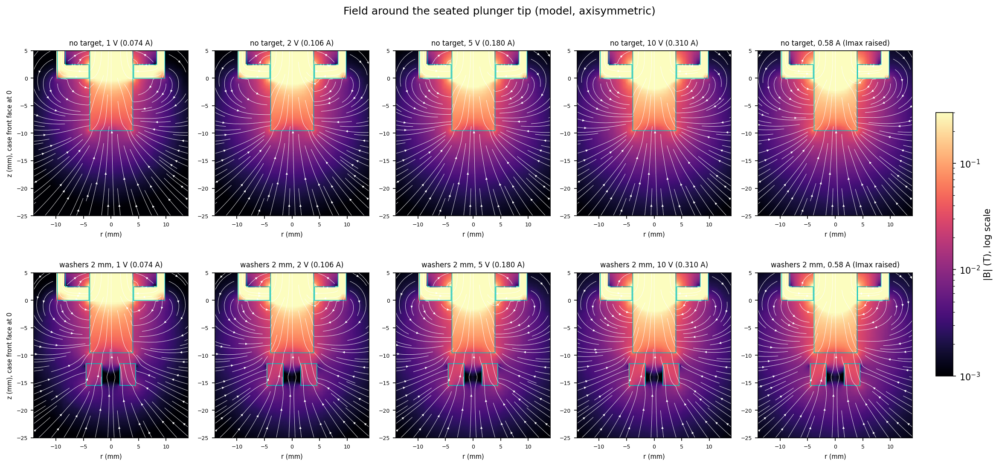

# Ledex 195224-230 field and target-force model (FEMM)

Axisymmetric magnetostatic model of the Ledex STA 20 × 40 mm pull solenoid (60° plunger, plunger
fully seated) attracting a steel target in front of the protruding pull end. Built on 11 Oct 2026
to estimate the pull on the washer target before the holder and a force jig exist.
**These are model estimates, not measurements.** Calibrate with one scale measurement once the
printed holder and a gap jig are available.

## Main findings

- The pull on five stacked M3 washers is small: about **1.4 g-force (14 mN) at 2 mm** and
  **3.3 g at 1 mm** at 10 V (0.31 A), and about 0.7 g at 3 mm.
- It falls steeply with gap (roughly halves per extra millimetre near the tip), so the
  resistance fades within a few millimetres of the object moving away from the Ledex.
- It saturates with current: 1 V (0.074 A) already gives ~30 % of the 10 V force, and raising
  `Imax` to the rated 0.58 A adds only ~25 % over 10 V (1.7 g at 2 mm).
- The seated plunger gives the strongest target pull; holding the plunger out from its seat
  lowers it (stroke sweep).
- A bigger solid steel target helps: at 2 mm and 10 V a 16 × 6 mm disc gives ~3.3 g
  (2.4 × the washers), a 12 × 4 mm disc ~2.1 g. One washer gives only ~0.44 g.

| Gap | 1 V (0.074 A) | 2 V (0.106 A) | 5 V (0.180 A) | 10 V (0.310 A) | 0.58 A (Imax raised) |
| --- | --- | --- | --- | --- | --- |
| 1 mm | 1.03 g | 1.85 g | 2.58 g | 3.25 g | 4.02 g |
| 2 mm | 0.44 g | 0.79 g | 1.10 g | 1.39 g | 1.71 g |
| 3 mm | 0.23 g | 0.41 g | 0.57 g | 0.72 g | 0.89 g |
| 5 mm | 0.08 g | 0.14 g | 0.20 g | 0.26 g | 0.32 g |

Pull on five stacked M3 washers (3.2 × 9 × 0.8 mm, mild steel), plunger seated; 1 g = 9.81 mN.

## Model

- Published: case 19.56 mm dia × 39.37 mm, M14 boss 9.52 mm, plunger 7.82 mm dia, 1491 turns
  (30 AWG, 20.7 Ω), 60° plunger. Measured: coil current at each AO command (Checkpoint 4,
  `calibration/README.md`).
- Assumed (not published): case wall 1.5 mm, end plates 2.5 mm, bobbin 0.5 mm, 30° half-angle cone
  seated with a 0.1 mm residual gap, plunger protrusion 9.5 mm when seated, FEMM "1010 Steel" for
  every steel part, washer stack modelled as one solid 4 mm ring (real interfaces lower the force
  slightly). The PWM drive is modelled as its average DC current.
- Coordinates in the grids and plots: `r` radius, `z` axis, `z = 0` at the front face of the case,
  plunger tip at `z = -9.5`, targets below the tip.

## Validation and uncertainty

- Plunger force vs the datasheet (60° plunger, 0.58 A): seated holding 20.7 N vs 12.7 N
  (1.6 × high); at 1.5 / 3.2 / 6.4 / 9.5 mm stroke the model is 2.0 / 1.8 / 1.2 / 1.1 × high.
  The target force is therefore more likely over- than underestimated.
- Sensitivity at 2 mm (see `figures/plots/sensitivity.png`): plunger protrusion 6.35 / 12.7 mm
  changes the target force by +24 % / −17 %; seat gap, steel grade and mesh change it by less than
  10 % at 10 V (more at 1 V, up to ±35 %). Mesh is converged (< 1 %).
- Treat absolute numbers as uncertain by up to ~2×; trends (gap, current, target size) are reliable.

## Files

- `ledex_washer.lua`: the FEMM 4.2 model (modes `forces`, `profile`, `stroke`, `sweep`,
  `fieldgrid`, `map`).
- `run_femm.ps1`: first runs (`results/forces.csv`, `axial_B.csv`, `stroke.csv`) and FEMM
  FEMM screenshots in `figures/plots/femm/` (`overview.png` and one PNG per case; colour scale 0–0.05 T).
  Matplotlib redraws with readable legends are in `figures/readable/`.
- `run_sweeps.ps1`: all sweeps and field grids (about 30 min on the rig PC).
- `plot_results.py`: makes `figures/plots/*.png` from the CSVs (numpy + matplotlib; runs on the
  Mac). Edit it to plot things differently.
- `results/sweeps.csv`: one row per FEMM solve (319 rows). Columns: `case`, `target`,
  `target_id_mm`, `target_od_mm`, `target_t_mm` (inner/outer diameter, thickness; id 0 = solid
  disc), `protrude_mm`, `seat_mm`, `stroke_mm` (plunger held out from its seat), `steel`,
  `target_mesh_mm`, `gap_mm` (tip to target face), `current_A`, `target_force_N`,
  `target_force_g`, `plunger_force_N` (axial force on the plunger, toward the seat).
  Cases: `baseline_gap*` (five washers, 11 gaps × 12 currents), `target_*` (other targets),
  `stroke_*`, `sens_*`.
- `results/fieldgrid_<target>_<current>A.csv`: `r_mm, z_mm, Br_T, Bz_T, Bmag_T` on a 0.25 mm grid,
  r 0–20 mm, z −25 to 5 mm (no target at five currents; washers at 2 mm at five currents; washers
  at 1 mm at 0.31 and 0.58 A).
- Command voltage to current (minimum `Imax`): 0.5 V 0.053, 1 V 0.074, 2 V 0.106, 3 V 0.121,
  4 V 0.147, 5 V 0.180, 6 V 0.201, 8 V 0.273, 10 V 0.310 A; 0.40–0.58 A need `Imax` raised.

## Re-running (rig PC)

FEMM 4.2 is installed in `C:\femm42`. From this folder:
`powershell -ExecutionPolicy Bypass -File run_sweeps.ps1` (delete `results/sweeps.csv` first for a
clean run; `-Only <regex>` runs selected cases). FEMM crashes when it saves several bitmaps in one
session, so the scripts run one FEMM session per job.
