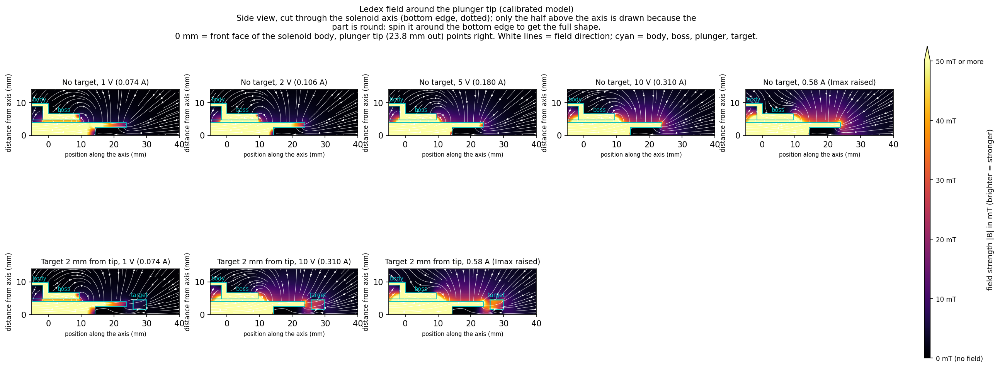
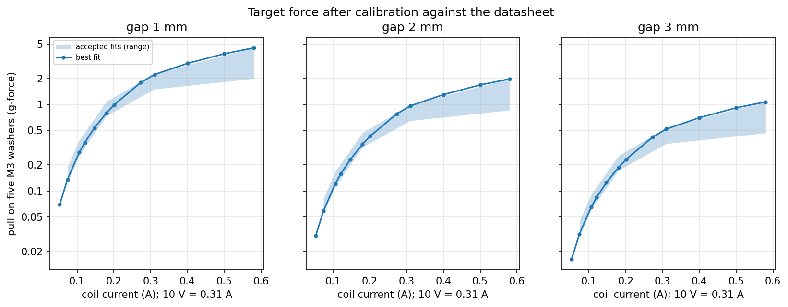
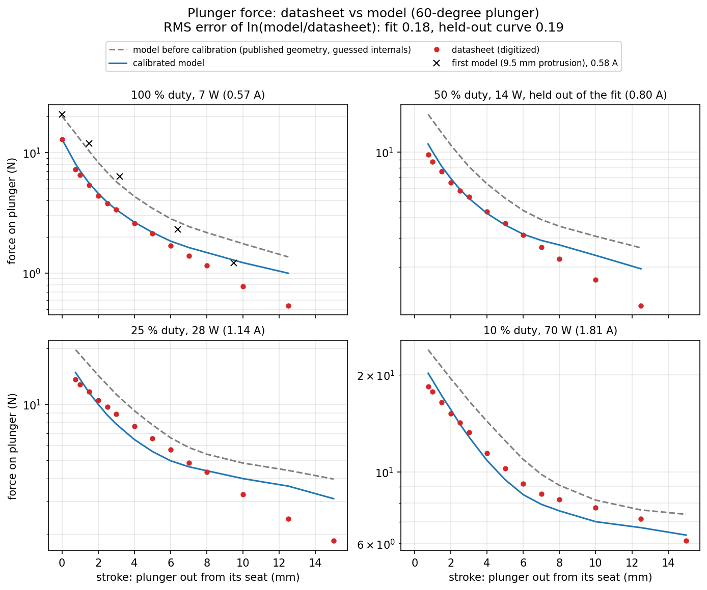

# Ledex 195224-230 field and target-force model (FEMM)

Axisymmetric magnetostatic model of the Ledex STA 20 × 40 mm pull solenoid (60° plunger, plunger
fully seated) attracting a steel target in front of the protruding pull end. Built on 11 Oct 2026
to estimate the pull on the washer target before the holder and a force jig exist, then calibrated
against the datasheet force-stroke curves (12 Oct 2026).
**These are model estimates, not measurements.** Check them with one scale measurement once the
printed holder and a gap jig are available.

## Main findings (calibrated model)

- The pull on five stacked M3 washers is very small at the currents the rig uses: about
  **1 g-force (9 mN) at 2 mm** and **2.2 g at 1 mm** at 10 V (0.31 A), 0.5 g at 3 mm.
- Below 10 V the force scales roughly with current squared: 1 V (0.074 A) gives only ~6 % of the
  10 V force (0.06 g at 2 mm). Raising `Imax` to the rated 0.58 A doubles the 10 V force
  (2.0 g at 2 mm).
- It falls steeply with gap (about 2× per extra millimetre near the tip), so the resistance
  fades within a few millimetres of the object moving away from the Ledex.
- One washer gives only ~0.28 g at 2 mm and 10 V. (Solid steel discs were also simulated and are in
  `results/sweeps.csv`, e.g. 16 × 6 mm ~2.3 g, but they are not available and not plotted.)
- Taller washer stacks help with diminishing returns (2 mm, 10 V; 0.58 A in brackets): 5 washers
  (4 mm, ~1.8 g) 0.96 g (2.0), 10 (~3.5 g) 1.6 g (3.3), 20 (~7 g) 2.5 g (5.1), 40 (~14 g) 3.4 g
  (7.1); the far washers sit in a weaker field and the stack is modelled as solid, so real stacks
  pull somewhat less.
- The seated plunger gives the strongest target pull; holding the plunger out from its seat
  lowers it (stroke sweep).

| Gap | 1 V (0.074 A) | 2 V (0.106 A) | 5 V (0.180 A) | 10 V (0.310 A) | 0.58 A (Imax raised) |
| --- | --- | --- | --- | --- | --- |
| 0.5 mm | 0.27 g | 0.54 g | 1.6 g | 4.3 g | 8.7 g |
| 1 mm | 0.14 g (0.13–0.19) | 0.28 g (0.26–0.39) | 0.80 g (0.74–1.1) | 2.2 g (1.5–2.3) | 4.5 g (2.0–4.5) |
| 2 mm | 0.059 g (0.055–0.082) | 0.12 g (0.11–0.17) | 0.35 g (0.32–0.47) | 0.96 g (0.65–1.0) | 2.0 g (0.86–2.0) |
| 3 mm | 0.032 g (0.029–0.044) | 0.065 g (0.060–0.091) | 0.19 g (0.17–0.25) | 0.52 g (0.35–0.54) | 1.1 g (0.47–1.1) |
| 5 mm | 0.012 g | 0.024 g | 0.070 g | 0.20 g | 0.41 g |

Pull on five stacked M3 washers (3.2 × 9 × 0.8 mm, mild steel), plunger seated; 1 g = 9.81 mN.
Best fit, with the range over the accepted calibration fits in brackets (1–3 mm only).
The first, uncalibrated model gave 3–7× more at 1–2 V and ~1.4× more at 10 V
(`results/uncalibrated/`).

## Calibration against the datasheet

- Data: Ledex STA pull 20 × 40 catalog (`datasheet/ledex_195224_sta_pull_20x40.pdf`). The 60°
  plunger force-stroke chart (page F19, `datasheet/chart_60deg_force_stroke.png`) was digitized
  with `datasheet/digitize.py` into `datasheet/ledex_195224_60deg_force_stroke.csv`: four curves
  (100/50/25/10 % duty = 7/14/28/70 W = 855/1200/1700/2700 ampere-turns = 0.57/0.80/1.14/1.81 A
  at 1491 turns, 20 °C coil), 0.75–15 mm stroke, plus the 12.8 N holding force.
  `datasheet/digitize_check.png` overlays the digitized points on the chart.
- Geometry from the drawing (page F34, `datasheet/drawing_pull_F34.png`, energised = seated):
  the pull end sits 19.05 + 4.76 = **23.81 mm** beyond the body face (the 9.5 mm used before is
  the depth of the 2.5 mm tip slot), the M14 × 1.5 boss is 9.52 mm long on the plunger side, and
  the plunger length follows from its 20.1 g mass.
- Fitted (not published): seat gap (air-gap spacer), radial clearance (nylon bearing), steel
  saturation scale on the 1010 B-H curve, end-plate thickness, case wall, cone half-angle. The
  plan fixed the cone at 30° and did not fit the clearance; with those fixed the holding force
  stayed 1.5× high, so both were added.
- Method (`calibrate.py`): error = RMS of ln(model / datasheet) over the 100/25/10 % curves and the
  holding force; the 50 % curve is held out as a check. 60-set Latin-hypercube screen, two
  Nelder-Mead runs from the best distinct starts (both converged to the same region), then 48
  random sets around the optimum: 249 parameter sets, 60 FEMM solves each.
- Result: fitted error 0.18 (before: 0.44), **held-out 50 % curve 0.19** (before: 0.51), i.e.
  typically within ±15–20 %. Up to 7 mm stroke the model is within about ±15 % at all four
  currents; beyond 8 mm stroke it still reads 1.4–2× high at 0.57–1.14 A. Seated holding force
  13.0 N vs 12.8 N. See `figures/plots/calibration_fit.png`.
- Best fit (`results/calibration/best_params.json`): seat gap 1.0 mm, clearance 0.8 mm, steel
  scale 0.98, plates 1.58 mm, wall 0.8 mm, cone half-angle 37.5°. Seat gap, clearance and wall
  sit on their bounds, so treat them as effective values that make the magnetic circuit right,
  not as real dimensions.
- Uncertainty band: 134 sets fit within 1.2× the best error (`accepted_sets.csv`; seat gap
  0.52–1.0 mm, clearance 0.68–0.8 mm, steel scale 0.82–1.05, plates 1.5–2.8 mm, wall 0.8–1.6 mm,
  cone 30–42°). The target force was recomputed for 16 well-spread ones
  (`results/calibration/target_band.csv`); the table brackets are their range.

Caveats:

- The datasheet only gives the plunger force, and only at 0.57–1.81 A. The target force (the
  fringe field outside the body) and the rig currents (0.05–0.31 A) are both outside the fitted
  data. The model is linear (force ∝ current²) at those currents, as the datasheet curves are
  between 0.57 and 0.80 A, so the extrapolation is plausible but untested.
- The remaining long-stroke error (model high when the plunger is mostly out, where fringe
  field matters most) suggests the target force is, if anything, still overestimated.
- Sensitivity of the calibrated model at 2 mm (`figures/plots/sensitivity.png`): protrusion
  ±0.3 mm (drawing tolerance) ±3 %, no tip slot +9 %, other steel grades −12 to +9 %, mesh < 1 %.
- Treat absolute numbers as uncertain by about ±40 %; trends (gap, current², target size) are
  reliable. One measurement at 2 mm will settle the scale.

## Model

- Published: case 19.56 mm dia × 39.37 mm, M14 boss 9.52 mm, plunger 7.82 mm dia and 20.1 g,
  23.81 mm protrusion, 2.5 × 9.5 mm tip slot (modelled as an equal-area axial hole),
  1491 turns (30 AWG, 20.7 Ω), 60° plunger. Measured: coil current at each AO command
  (Checkpoint 4, `calibration/README.md`).
- Fitted: see above. Assumed: bobbin 0.5 mm, 1 mm flat at the cone apex, FEMM "1010 Steel" for
  the target, washer stack modelled as one solid 4 mm ring (real interfaces lower the force
  slightly). The PWM drive is modelled as its average DC current.
- Coordinates in the grids: `r` radius, `z` axis, `z = 0` at the front face of the case body,
  boss at −9.52 < z < 0, plunger tip at `z = -23.81`, targets beyond the tip. The readable
  figures turn this sideways (x = −z).

## Files

- `ledex_washer.lua`: the FEMM 4.2 model (modes `forces`, `profile`, `stroke`, `sweep`,
  `plunger`, `fieldgrid`, `map`). Every parameter can be overridden by the caller; defaults are
  the calibrated values.
- `femm_run.py`: runs FEMM in parallel on Windows or on a Mac under Wine (Python 3.6+, standard
  library only). `python3 femm_run.py sweeps` (all sweeps and field grids; `--only <regex>`,
  `--no-grids`), `summary` (`results/forces.csv`, `axial_B.csv` (field along the plunger outer edge r = 3.91 mm, not the slotted axis), `stroke.csv`), `maps` (FEMM
  screenshots in `figures/plots/femm/`, needs Pillow for PNG). `FEMM_WORKERS` sets the number of
  parallel FEMM processes.
- `calibrate.py`: the datasheet fit (`screen`, `refine`, `explore`, `best`, `band`, or `all`);
  writes `results/calibration/` (`fit_log.csv` one row per parameter set, `fit_points.csv` model
  vs datasheet per point, `best_params.json`, `accepted_sets.csv`, `target_band.csv`).
- `plot_results.py`: makes `figures/plots/*.png` and `figures/readable/*.png` from the CSVs
  (numpy + matplotlib).
- `results/sweeps.csv`: one row per FEMM solve (319 rows). Columns: `case`, `target`,
  `target_id_mm`, `target_od_mm`, `target_t_mm` (inner/outer diameter, thickness; id 0 = solid
  disc), `protrude_mm`, `seat_mm`, `stroke_mm` (plunger held out from its seat), `bscale`,
  `tpl_mm`, `wall_mm`, `steel`, `target_mesh_mm`, `gap_mm` (tip to target face), `current_A`,
  `target_force_N`, `target_force_g`, `plunger_force_N` (axial force on the plunger, toward the
  seat), `clr_mm`, `conea_deg`. Cases: `baseline_gap*` (five washers, 11 gaps × 12 currents),
  `target_*` (other targets), `stroke_*`, `sens_*`.
- `results/fieldgrid_<target>_<current>A.csv`: `r_mm, z_mm, Br_T, Bz_T, Bmag_T` on a 0.25 mm grid,
  r 0–20 mm, z −45 to 5 mm (no target at five currents; washers at 2 mm at five currents; washers
  at 1 mm at 0.31 and 0.58 A).
- `results/uncalibrated/`: the first model (9.5 mm protrusion, guessed internals), kept for
  comparison.
- `figures/readable/`: field maps with a mT colour scale (overview plus one PNG per panel);
  `figures/plots/femm/`: raw FEMM screenshots (colour scale 0–0.05 T).
- Command voltage to current (minimum `Imax`): 0.5 V 0.053, 1 V 0.074, 2 V 0.106, 3 V 0.121,
  4 V 0.147, 5 V 0.180, 6 V 0.201, 8 V 0.273, 10 V 0.310 A; 0.40–0.58 A need `Imax` raised.

## Running FEMM

Rig PC: FEMM 4.2 is installed in `C:\femm42`; run `python femm_run.py sweeps` from this folder
(4 parallel FEMM processes by default). Full sweeps take about 5 minutes on a Mac with 10 workers;
the calibration took about 2.5 hours.

Mac (Apple Silicon) under Wine, as set up on 11 Oct 2026:

1. `softwareupdate --install-rosetta --agree-to-license`
2. Wine: download `wine-staging-11.18-osx64.tar.xz` from
   [Gcenx/macOS_Wine_builds](https://github.com/Gcenx/macOS_Wine_builds/releases) and unpack it to
   `~/Applications/wine/` (gives `Wine Staging.app`; the Homebrew casks are disabled).
3. `WINEPREFIX=~/.wine-femm wineboot` to create the prefix.
4. FEMM: the installer crashes under Wine, so unpack it instead: download
   `femm42bin_x64_21apr2019.exe` from [femm.info](https://www.femm.info/wiki/Download),
   `brew install innoextract`, `innoextract -s femm42bin_x64_21apr2019.exe`, then copy `app/` to
   `~/.wine-femm/drive_c/femm42`.
5. FEMM needs `mfc90.dll`: run the extracted `tmp/vcredist_x64.exe /q` under Wine with the same
   prefix.
6. `femm_run.py` finds Wine at the default path (override with `FEMM_WINE`, prefix with
   `WINEPREFIX`). A Lua error opens a dialog that blocks FEMM until the job timeout; bitmap export
   needs a visible window.
