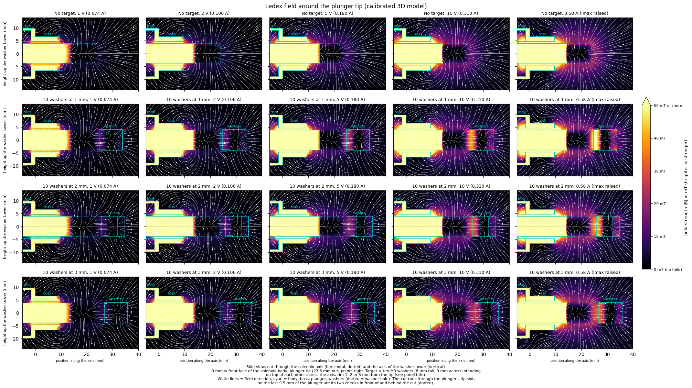
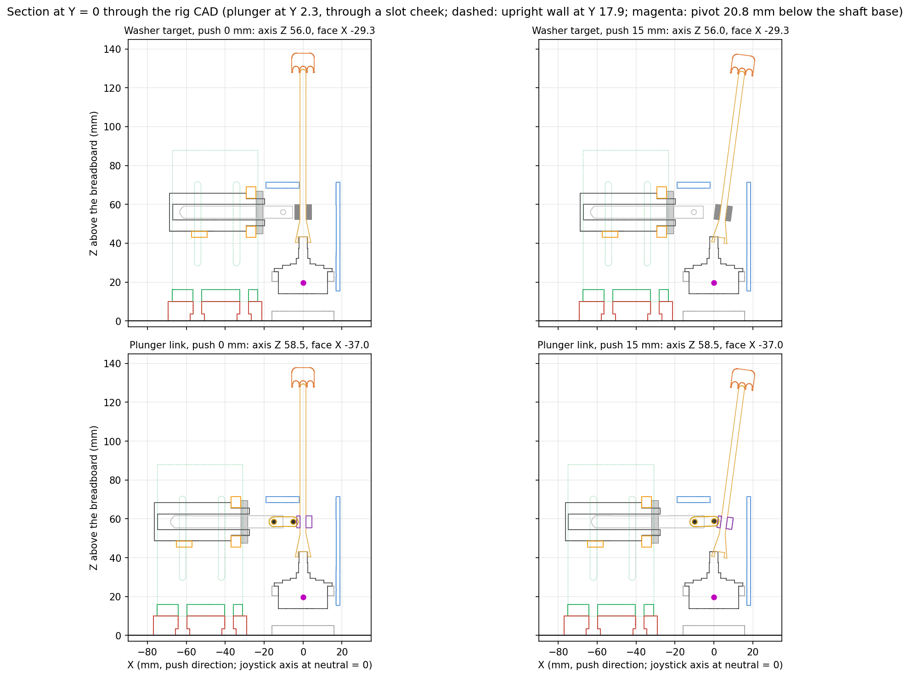
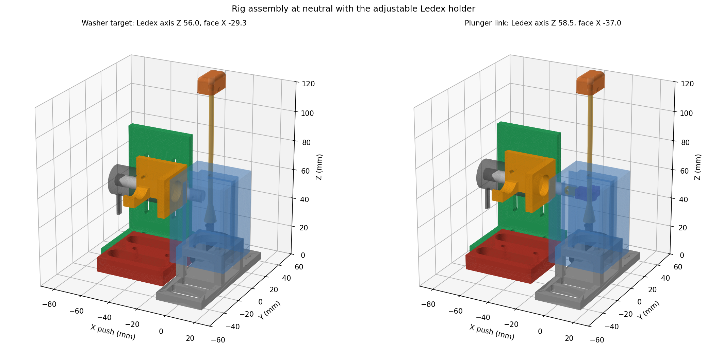
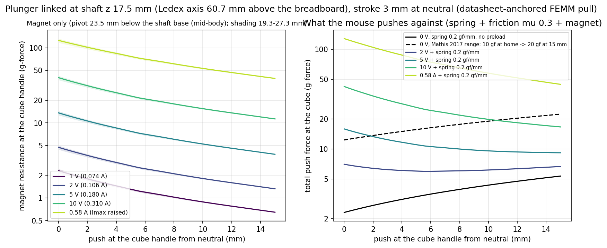
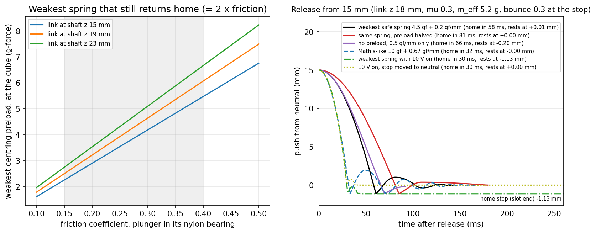
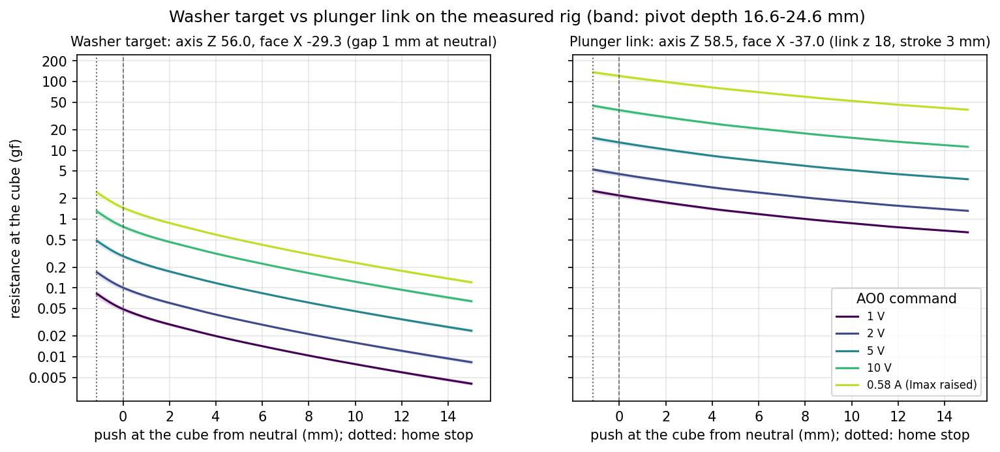
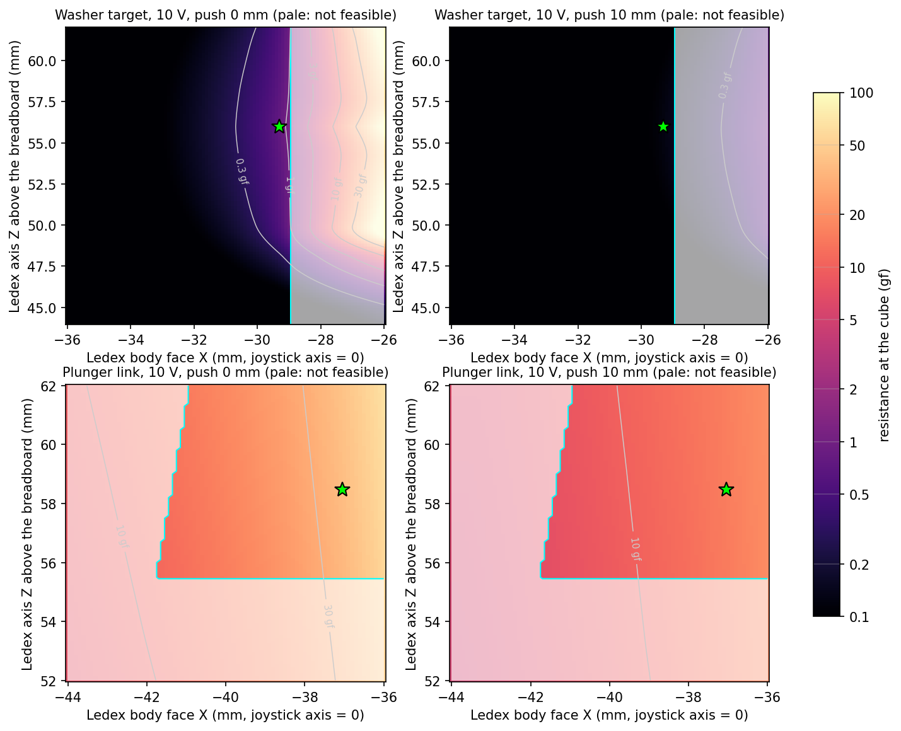

# Ledex 195224-230 field and target-force models (FEMM calibration, 3D target forces)

Two magnetostatic models of the Ledex STA 20 × 40 mm pull solenoid (60° plunger) and a steel washer
target in front of the protruding pull end, built on 11-12 Oct 2026 to estimate the resistance force
before the printed holder and a force jig exist.

- **FEMM (2D, axisymmetric)** reproduces the plunger force and was calibrated against the datasheet
  force-stroke curves. It cannot represent washers standing across the axis.
- **3D (NGSolve, `fea3d.py`)** rebuilds the same calibrated device and computes the pull on the
  washer tower standing across the axis with its rim facing the tip (the real layout).

All target forces, field maps and plots in `figures/plots/` and `figures/magnetic_fields/` come from the
3D model, except `calibration_fit.png` and `sensitivity.png` (FEMM). **These are model estimates, not
measurements.** Check them with one scale measurement once the printed holder and a gap jig are available.

Outcome: on the measured rig (15 Oct, section "Washer target vs plunger link") the washer target gives
under 1 gf at the handle at 10 V, so the chosen design links the plunger itself to the joystick shaft
(section "Plunger link"; ~2-120 gf at neutral over the command range, ~50× the washers).

## Main findings (3D model, ten M3 washers standing across the axis, plunger seated)

- The pull is very small at the currents the rig uses: about **1.2 g-force (12 mN) at 2 mm** and
  **2.5 g at 1 mm** at 10 V (0.31 A), 0.7 g at 3 mm.
- Below 10 V the force scales roughly with current squared: 1 V (0.074 A) gives only ~6 % of the
  10 V force (0.08 g at 2 mm). Raising `Imax` to the rated 0.58 A (the most the 12 V supply can push
  through the 20.7 Ω coil) gives about 1.8× the 10 V force (2.2 g at 2 mm, 4.7 g at 1 mm).
- It falls steeply with gap (roughly 2× per extra millimetre near the tip), so the resistance fades
  within a few millimetres of the object moving away from the Ledex.
- Taller towers help with diminishing returns (2 mm; 0.58 A in brackets, 10 V first): 1 washer
  0.39 g (0.75), 5 washers 0.79 (1.5), 10 washers 1.2 (2.2), 20 washers 1.6 (2.9), 40 washers 2.3 (4.4).
  Each washer is 0.8 mm thick (10 washers = 8 mm, about 3.5 g of mass on the joystick), the far
  washers sit in a weaker field, and the tower is modelled as solid, so real towers pull somewhat less.
- The seated plunger gives the strongest pull; holding it out from its seat lowers it (10 V, 2 mm:
  1.2 g seated, 0.63 g at 1.5 mm out, 0.13 g at 9.5 mm out).

| Gap | 1 V (0.074 A) | 2 V (0.106 A) | 5 V (0.180 A) | 10 V (0.310 A) | 0.58 A (Imax raised) |
| --- | --- | --- | --- | --- | --- |
| 0.5 mm | 0.33 g | 0.68 g | 1.9 g | 5.2 g | 9.7 g |
| 1 mm | 0.16 g | 0.32 g | 0.93 g | 2.5 g | 4.7 g |
| 2 mm | 0.075 g | 0.15 g | 0.44 g | 1.2 g | 2.2 g |
| 3 mm | 0.043 g | 0.089 g | 0.26 g | 0.68 g | 1.3 g |
| 5 mm | 0.018 g | 0.036 g | 0.10 g | 0.28 g | 0.52 g |
| 6 mm | 0.012 g | 0.025 g | 0.070 g | 0.19 g | 0.35 g |
| 8 mm | 0.006 g | 0.012 g | 0.035 g | 0.094 g | 0.18 g |
| 10 mm | 0.003 g | 0.007 g | 0.019 g | 0.051 g | 0.097 g |

Pull on ten stacked M3 washers (3.2 × 9 × 0.8 mm, mild steel) standing across the axis, plunger
seated; 1 g = 9.81 mN. Best-fit calibration. Range over the best fit and 13 other accepted calibration sets (two more could
not be meshed), 1 / 2 / 3 mm: 10 V 1.6-2.5 / 0.76-1.2 / 0.44-0.70 g; 0.58 A 2.2-5.6 / 1.1-2.2 /
0.62-1.3 g; 1 V 0.15-0.23 / 0.07-0.11 / 0.04-0.06 g. The best fit sits at the top of each range, so the
true pull is more likely below it than above (`figures/plots/target_force_band.png`). (The earlier FEMM five-washer ring gave about 0.96 g at 2 mm
and 10 V, in `results/femm/femm_sweeps.csv`; it is not the real layout.)

## Calibration against the datasheet

- Data: Ledex STA pull 20 × 40 catalog (`datasheet/ledex_195224_sta_pull_20x40.pdf`). The 60°
  plunger force-stroke chart (page F19, `datasheet/chart_60deg_force_stroke.png`) was digitized
  with `datasheet/digitize.py` into `datasheet/ledex_195224_60deg_force_stroke.csv`: four curves
  (100/50/25/10 % duty = 7/14/28/70 W = 855/1200/1700/2700 ampere-turns = 0.57/0.80/1.14/1.81 A
  at 1491 turns, 20 °C coil), 0.75–15 mm stroke, plus the 12.8 N holding force.
  `datasheet/digitize_check.png` overlays the digitized points on the chart.
- Geometry from the drawing (page F34, `datasheet/drawing_pull_F34.png`, energised = seated):
  the pull end sits 19.05 + 4.76 = **23.81 mm** beyond the body face (the 9.5 mm used before is
  the depth of the 2.5 mm tip slot), the M14 × 1.5 boss is 9.52 mm long on the plunger side, and
  the plunger length follows from its 20.1 g mass.
- Fitted (not published): seat gap (air-gap spacer), radial clearance (nylon bearing), steel
  saturation scale on the 1010 B-H curve, end-plate thickness, case wall, cone half-angle. The
  plan fixed the cone at 30° and did not fit the clearance; with those fixed the holding force
  stayed 1.5× high, so both were added.
- Method (`calibrate.py`): error = RMS of ln(model / datasheet) over the 100/25/10 % curves and the
  holding force; the 50 % curve is held out as a check. 60-set Latin-hypercube screen, two
  Nelder-Mead runs from the best distinct starts (both converged to the same region), then 48
  random sets around the optimum: 249 parameter sets, 60 FEMM solves each.
- Result: fitted error 0.18 (before: 0.44), **held-out 50 % curve 0.19** (before: 0.51), i.e.
  typically within ±15–20 %. Up to 7 mm stroke the model is within about ±15 % at all four
  currents; beyond 8 mm stroke it still reads 1.4–2× high at 0.57–1.14 A. Seated holding force
  13.0 N vs 12.8 N. See `figures/plots/calibration_fit.png`.
- Best fit (`results/calibration/best_params.json`): seat gap 1.0 mm, clearance 0.8 mm, steel
  scale 0.98, plates 1.58 mm, wall 0.8 mm, cone half-angle 37.5°. Seat gap, clearance and wall
  sit on their bounds, so treat them as effective values that make the magnetic circuit right,
  not as real dimensions.
- Uncertainty band: 134 sets fit within 1.2× the best error (`accepted_sets.csv`; seat gap
  0.52–1.0 mm, clearance 0.68–0.8 mm, steel scale 0.82–1.05, plates 1.5–2.8 mm, wall 0.8–1.6 mm,
  cone 30–42°). The 3D target force of the ten-washer tower was recomputed for 16 well-spread ones
  (`sweep3d.py band`, rows with a numeric `set` in `results/fea3d/force_sweep_3d.csv`) and gives the bars and
  shading in `force_vs_gap.png`, `force_vs_current.png` and `target_force_band.png`.

Caveats:

- The datasheet only gives the plunger force, and only at 0.57–1.81 A. The target force (the
  fringe field outside the body) and the rig currents (0.05–0.31 A) are both outside the fitted
  data. The model is linear (force ∝ current²) at those currents, as the datasheet curves are
  between 0.57 and 0.80 A, so the extrapolation is plausible but untested.
- The remaining long-stroke error (model high when the plunger is mostly out, where fringe
  field matters most) suggests the target force is, if anything, still overestimated.
- Sensitivity of the calibrated model at 2 mm (`figures/plots/sensitivity.png`): protrusion
  ±0.3 mm (drawing tolerance) ±3 %, no tip slot +9 %, other steel grades −12 to +9 %, mesh < 1 %.
- Treat absolute numbers as uncertain by about ±40 %; trends (gap, current², target size) are
  reliable. One measurement at 2 mm will settle the scale.

## 3D model: washers standing across the axis

FEMM is axisymmetric, so it can only model washers stacked on the axis as a ring. The real layout is a
tower of washers standing across the solenoid axis, with the tip facing the rims. `fea3d.py` is a
quarter-symmetry 3D magnetostatic model (NGSolve, edge elements, nonlinear 1010 B-H with the fitted
BSCALE, Maxwell-stress force) that reuses the calibrated geometry. It can also hold the plunger out
from its seat (`stroke`). It gives the pull on the target only; the force on the plunger is not
computed. Setup: `python3 -m venv /tmp/ngenv && /tmp/ngenv/bin/pip install ngsolve numpy scipy`.

Validation: a coaxial ring of 5 washers, 2 mm, 0.31 A gives 0.90 g in 3D (mesh and box changes move it
by under 2 %) against 0.96 g in FEMM, so the 3D model is about 6 % low.

Pull (g-force) of a washer tower across the axis, tip to nearest rim, 0.58 A (10 V, 0.31 A, in brackets):

| washers | 1 mm | 2 mm | 3 mm |
|---|---|---|---|
| 1 | 1.2 (0.63) | 0.75 (0.39) | 0.50 (0.26) |
| 5 | 2.5 (1.4) | 1.5 (0.79) | 0.93 (0.49) |
| 10 | 4.7 (2.5) | 2.2 (1.2) | 1.3 (0.68) |
| 20 | 6.8 (3.4) | 2.9 (1.6) | 1.7 (0.91) |
| 40 | 8.9 (5.0) | 4.4 (2.3) | 2.4 (1.3) |

Gains from extra washers flatten past 10. Uncertainty: about ±10 % from the nonlinear iteration near
saturation at 0.58 A, plus the calibration extrapolation (±40 %).

## Rig geometry (measured CAD, 15 Oct 2026)

`rig_geometry.py` is the single source of the rig dimensions for every model here. It reads the
measured joystick component and component holder (`mechanical/3d-print/joystick-component/`,
`joystick-holder/`), the constrainer, shaft and cube STLs, places them in one world frame and writes
`results/rig/stackup.csv`. World frame: X along the push (+X away from the mouse), Y lateral, Z up from
the breadboard, origin under the joystick axis. The lever models use x = X and z = height above the
shaft base.

| item | world Z (mm) |
| --- | --- |
| holder base top / frame top (component flange seat) | 5.00 / 25.41 |
| component body bottom | 13.88 |
| pivot (mid-body, assumed) | 19.64 |
| shaft base | 40.48 |
| constrainer (socket ledge on the frame top) | 15.41-71.41 |
| washer tower (10 × M3 on the shaft cone) | 51.98-59.98 |
| window in the constrainer's home wall (Y ±8, square top; the original arch top was 63.41) | 68.41 |
| constrainer slot plate | 68.41-71.41 |
| cube push contact | 132.88 |

- Pivot: not published; taken at the middle of the component body, **20.8 mm below the shaft base**,
  with 16.6 and 24.6 mm (body z 10 and 2) as the bounds in every figure.
- The constrainer slot runs from Y −2 to 17 (4 mm wide). Its home end stops the shaft at **−1.13 mm at
  the cube** (home side of the vertical, i.e. of the spring's neutral); its far end allows 35.2 mm. A
  15 mm push tilts the shaft 7.6°.
- Constrainer: the model uses the window revision
  (`mechanical/3d-print/joystick-1d-axis-constrainer/make_ledex_window.py`): the home-wall arch is cut
  square up to the cavity ceiling, same 16 mm width, so the plunger and the link pin have room.
- Ledex placement limits: the plunger (+1 mm) passes through the window, so its axis must be at Z
  30.3-63.5; the M14 nut must stay 1 mm clear of the constrainer's outer wall (X −19), so the body face
  must be at X ≤ −28.5; the Ledex holder covers axis heights 30-70.

**Rig explorer:** `figures/rig/rig_explorer.html` (open in a browser; needs internet for three.js and
Plotly). All parts in 3D, sliders for the option, Ledex distance, height and lateral position, push,
AO0 command or raised Imax, pivot depth, spring preload and rate and plunger friction; live readouts
(gap or stroke, offset, pull, handle force, spring, friction, push needed to hold, whether the magnet
pulls the handle onto the home stop), feasibility checks, force-vs-push and force-vs-command plots and a
live design map. Its force model is a JavaScript port that `rig_explorer.py` checks against
`rig_forces.py` (within 0.03 %) before writing the page.

## Joystick lever: how far the tower moves per push

`lever.py` treats the shaft as a rigid lever about the thumbstick pivot and turns a push at the cube
handle into tower motion, gap and resistance (`results/lever/lever_table.csv`,
`figures/plots/lever_target_motion.png`, `figures/plots/lever_force_vs_push.png`).

- Base: APEM TS-1D1S00A-1294 Hall thumbstick (Mathis 2017, Digi-Key 679-2501-ND), castle cap removed,
  printed shaft screwed onto the lever stub. Heights from the measured component and holder
  (section above); pivot 20.8 mm below the shaft base (16.6-24.6).
- Ten M3 washers seat on the cone at 11.5-19.5 mm above the shaft base; the cube handle spans
  87.4-97.4 mm (push taken at 92.4 mm). The three cube holes change the result by < 0.02 mm.
- The tower moves about a third of the push (rigid rotation, not small-angle):

| push at the cube | 1 mm | 2 mm | 5 mm | 10 mm | 15 mm |
| --- | --- | --- | --- | --- | --- |
| tower moves (pivot 16.6 / 20.8 / 24.6 mm) | 0.30 / 0.32 / 0.34 | 0.59 / 0.64 / 0.69 | 1.5 / 1.6 / 1.7 | 3.0 / 3.2 / 3.4 | 4.4 / 4.8 / 5.2 mm |
| tilt (pivot 20.8 mm) | 0.5° | 1.0° | 2.5° | 5.1° | 7.6° |

- Resistance at the handle = tower pull × (tower height / handle height above the pivot) ≈ 0.32 of the
  tower pull. With the tower centred on the axis and a 1 mm gap at neutral, 10 V gives 0.59 gf at 1 mm
  push, 0.26 at 5 mm and 0.06 at 15 mm. The stock thumbstick spring is far stiffer (Mathis 2017: about
  4 N), and Mathis replaced it to bring the force down to 0.1-0.2 N (10-20 g); even against that the
  washer target adds only a few percent. This is why the plunger link below was chosen instead.
- Assumptions: rigid shaft, no play in the stub or the 1D constrainer, push = forward travel of the
  cube face at mid-height, coil current constant. The tower tilt (up to ~8°) and its ~0.1 mm drop are
  not in the force model.
- Rig check that replaces the pivot guess: push the cube 10 mm against a ruler and measure how far
  the shaft moves at the washer height (calipers). With ratio r = tower move / push, the pivot depth
  is (92.4 r − 15.5) / (1 − r) mm. Also note: the lever geometry gives ~5.1° for a 10 mm push, i.e.
  ~0.51 V if the 0-5 V output spans the full 50° travel, against the provisional 0.30 V eyeball
  reading in `calibration/joystick-volts-mm.md`; the ruler check settles both.

## Plunger link: the plunger itself as the resistance (chosen design)

The washer target gives ~1 g at the handle; the task needs ~10-100 g. The plunger is the strong part
of the solenoid (5.35 N at 1.5 mm stroke, 0.57 A, vs ~0.02 N on the washers at 2 mm), so it is linked to
the shaft: a rigid link (10 mm pin to pin) joins the plunger's pull end to a collar pin 5 mm from the
shaft axis on the home (mouse) side (5 mm leaves room for a printed split collar). A forward push draws
the plunger out of the coil and the coil pulls it back, so the resistance opposes the push.
`plunger_link.py` models this on the measured geometry (`rig_geometry.py`); the parts are in
`mechanical/3d-print/ledex-holder-adjustable/`.

- Plunger pull: new FEMM run with no target (`femm_run.py plunger`, 0.5-13 mm stroke, nine currents),
  scaled at each stroke so that the 0.5734 A curve matches the datasheet 100 % duty curve (the FEMM model
  reads up to 1.9× high at long stroke). The same scale is used at all currents.
- Kinematics: rigid shaft rotating about the pivot; the plunger pin stays on the Ledex axis. The handle
  force is the plunger pull × 0.343 (link height over the cube height above the pivot).
- Plunger end (datasheet drawing F34, model in `mechanical/3d-print/ledex-195224-model/`): the pull end
  has a 2.5 × 9.5 mm slot across its diameter and a factory 2.5/2.6 mm cross hole through both cheeks
  4.76 mm from the tip; the link bar (2.0 × 5 mm) goes in the slot and the pin through that hole, so
  nothing is drilled. The slot is turned vertical (pin along Y).
- Link height: the collar (6 mm) must sit on the straight 3 mm part of the shaft (pin at shaft z ≥ 15)
  and the plunger must pass 1 mm under the window top (z ≤ 23.0). Height barely matters for force
  (10 V, s0 3 mm: z 15 / 18 / 23 give 35 / 38 / 43 gf at neutral and 11.1-11.4 gf at 15 mm), so the link
  stays low with room above. **Recommended: link at shaft z 18 (Ledex axis Z 58.5), home stroke s0 = 3 mm
  at neutral (body face X −37.05)**; never 0:
  seated, the plunger holds with 12.8 N. A 15 mm push takes the stroke from 3.0 to 8.2 mm; the link tilts
  by at most 1.8°.
- Magnet resistance at the cube handle (gf, pivot 20.8 mm; a pivot at 16.6 / 24.6 mm gives −7 / +6 % at
  neutral and ±1 % at 15 mm, the shading in `handle_force_vs_push.png`):

| push at the cube | 0 mm | 1 mm | 2 mm | 5 mm | 10 mm | 15 mm |
| --- | --- | --- | --- | --- | --- | --- |
| 1 V (0.074 A) | 2.2 | 2.0 | 1.7 | 1.3 | 0.87 | 0.64 |
| 2 V (0.106 A) | 4.5 | 4.0 | 3.6 | 2.6 | 1.8 | 1.3 |
| 5 V (0.180 A) | 13 | 12 | 10 | 7.6 | 5.2 | 3.8 |
| 10 V (0.310 A) | 38 | 34 | 30 | 22 | 15 | 11 |
| 0.58 A (Imax raised) | 121 | 109 | 99 | 76 | 52 | 39 |

  The command range spans ~1-120 gf, so graded random forces are possible without new hardware. A
  smaller home stroke gives more at neutral but the force then falls off faster with the push
  (`design_space.png`, 10 V, link z 18: s0 1.5 mm 73 → 15 gf over 15 mm, 3 mm 38 → 11, 5 mm 21 → 8.3).
  The deeper measured pivot and the higher link raise the forces by ~40 % over the 12 Oct estimate.
- **Home stop.** The constrainer slot's home end stops the shaft 1.13 mm (at the cube) on the home side of
  the vertical, the spring's neutral. Whenever the magnet's pull at home beats the spring preload plus
  friction (at 10 V: 38 gf against ~5-7 gf) it pulls the handle back onto that stop, so the home position
  moves by 1.1 mm (~0.06 V on `ai1`) when the magnet is on. Fix before relying on it: move the stop to the
  neutral or just past it (slot end at Y −1.5 instead of −2, or a 0.5 mm shim at the slot end), or set
  the home window and record the magnet state per trial. `spring_return.png` shows both cases.
- Spring (handle-equivalent force at the cube, as a scale pressed by the cube reads it; P0 toward
  neutral on each side plus k × push). Friction is the plunger weight (20.1 g) on its nylon bearing × mu
  (0.15-0.4) plus 0.5 gf for the pins: 1.2 / 2.2 / 2.9 gf at the handle for mu 0.15 / 0.3 / 0.4. The
  weakest spring that still returns home reliably has 2 × that at home: **~2.4-5.9 gf preload (4.5 gf
  for mu 0.3)**; 6.3 gf covers every pivot and link height up to mu 0.4 (`spring_requirement.csv`). The
  thumbstick's own friction is part of the measured spring curve.
- Return after release from 15 mm (`spring_return.png`; effective mass at the cube 5.2 g from the
  printed shaft and cube, solid PLA, plus the plunger): weakest safe spring (4.5 gf + 0.2 gf/mm) reaches
  neutral in ~58 ms, a Mathis-like spring (10 gf at home, 20 gf at 15 mm) in ~32 ms; with 10 V on the
  magnet speeds the return (~30 ms) and then holds the handle on the stop. Without preload the handle
  stops wherever friction catches it after the bounce, so preload matters more than stiffness.
- Assumptions to confirm on the rig: pivot depth, collar pin 5 mm off axis, the plunger's cross hole at
  4.76 mm from the tip (datasheet ± 0.30), rigid link with free pins, no residual magnetism
  at 0 V, coil current constant during a push. Not modelled: the link's weight and the extra friction of
  the side load (the link stays within 1.8°, so the side load is < 4 % of the pull).
- Bench checks before relying on these numbers:
  1. Spring curve: press a gram scale with the cube at 0 / 5 / 10 / 15 mm, with and without the plunger
     linked, Ledex off. The difference is the friction; the preload at home should be ≥ 2× it.
  2. Release test: push to 15 mm and let go, 10 times; `ai1` must return to the home voltage within
     ±0.035 V every time (with and without the plunger).
  3. Hard stop: with 10 V on and the handle at home, the plunger must not seat (the stop holds the
     handle), note how far the home voltage moves, and the release at 0 V must be clean.
  4. Force at one or two commands with the scale at the cube (e.g. 5 V and 10 V at 5 mm push) to
     calibrate the model.

## Washer target vs plunger link on the measured rig (15 Oct 2026)

`rig_forces.py` places both options with the same two holder settings, the Ledex body face X (distance)
and axis height Z, and keeps only layouts that fit: plunger through the window, nut clear of the
constrainer, holder range, and for the washers no contact at the home stop (gap ≥ 0.3 mm there), for the
link the collar and window limits and a stroke within 0.75-12.5 mm from the home stop to a 15 mm push.
Washer pull comes from a new 3D sweep with the tower centre moved along its own vertical axis
(`sweep3d.py offset`, 7 gaps × 6 offsets at 0.31 A, scaled to other currents by the centred sweep).

- The tower is 8 mm tall, so offsets up to ~4 mm cost little (10 V, 1 mm gap: 2.4 / 2.2 / 2.0 / 1.8 /
  0.81 / 0.16 g at 0 / 2 / 4 / 6 / 8 / 11 mm offset). The tower centre is at Z 56.0, inside the window range.
- Recommended layouts (stars in `design_maps.png`): washers at Z 56.0, face X −29.3 (1 mm gap at
  neutral, 0.64 mm at the home stop); link at Z 58.5, face X −37.05 (link z 18, 3 mm home stroke).

| push at the cube | 0 mm | 1 mm | 2 mm | 5 mm | 10 mm | 15 mm |
| --- | --- | --- | --- | --- | --- | --- |
| washers, 1 V | 0.049 | 0.037 | 0.030 | 0.017 | 0.008 | 0.004 |
| washers, 10 V | 0.78 | 0.58 | 0.47 | 0.27 | 0.12 | 0.064 |
| washers, 0.58 A | 1.5 | 1.1 | 0.88 | 0.50 | 0.23 | 0.12 |
| link, 1 V | 2.2 | 2.0 | 1.7 | 1.3 | 0.87 | 0.64 |
| link, 10 V | 38 | 34 | 30 | 22 | 15 | 11 |
| link, 0.58 A | 121 | 109 | 99 | 76 | 52 | 39 |

Resistance at the cube (gf, pivot 20.8 mm; 16.6 / 24.6 mm: washers −8 / +7 %, link −7 / +6 % at neutral).

- **The plunger link wins by ~50× at neutral and ~175× at 15 mm.** The strongest feasible washer
  layout (gap 0.7 mm, face X −29.0) still gives only 1.2 gf at 10 V; the washer force also falls ~12×
  over a 15 mm push against ~3.4× for the link. Use the plunger link; the washer target stays rejected.
- The strongest feasible link layout on the 1 mm design grid (face X −36.0, Z 62.0: link z 21.5, home
  stroke 1.95 mm) gives 65 gf at 10 V at neutral but falls to 19 gf at 10 mm; 3 mm keeps a margin from
  the 0.75 mm datasheet limit and a flatter curve.
- Holder: `mechanical/3d-print/ledex-holder-adjustable/` (slotted base along X, lateral slots, vertical
  slots with a 1 mm scale, stroke and gap gauges, link collar and bar). Both layouts clear the
  joystick holder, component and constrainer (link ≥ 11.4 mm, washers ≥ 4.3 mm). Moving link parts,
  home stop to 15 mm: ≥ 1.0 mm (link end to shaft inside the clevis; plunger tip to collar 1.4 mm; pin,
  collar and plunger to the constrainer ≥ 3 mm).

## Model

- Published: case 19.56 mm dia × 39.37 mm, M14 boss 9.52 mm, plunger 7.82 mm dia and 20.1 g,
  23.81 mm protrusion, 2.5 × 9.5 mm tip slot (modelled as an equal-area axial hole),
  1491 turns (30 AWG, 20.7 Ω), 60° plunger. Measured: coil current at each AO command
  (Checkpoint 4, `calibration/README.md`).
- Fitted: see above. Assumed: bobbin 0.5 mm, 1 mm flat at the cone apex, "1010 Steel" for the
  target, washer tower modelled as solid steel (real interfaces between washers lower the force
  slightly). The PWM drive is modelled as its average DC current.
- Coordinates: `z = 0` at the front face of the case body, boss at −9.52 < z < 0, plunger tip at
  `z = -23.81`, targets beyond the tip. The field-map figures turn this sideways (position along
  the axis x = −z; 0 mm = body face, tip at 23.8 mm).

## Files

- `ledex_washer.lua`: the FEMM 4.2 model (modes `forces`, `profile`, `stroke`, `sweep`,
  `plunger`, `fieldgrid`, `map`). Every parameter can be overridden by the caller; defaults are
  the calibrated values.
- `femm_run.py`: runs FEMM in parallel on Windows or on a Mac under Wine (Python 3.6+, standard
  library only). `python3 femm_run.py sweeps` (all sweeps and field grids; `--only <regex>`,
  `--no-grids`), `summary` (`results/femm/femm_forces_5washers_coaxial.csv`, `femm_field_along_plunger_edge_no_target.csv` (along the plunger outer edge r = 3.91 mm, not the slotted axis), `femm_stroke_5washers_coaxial.csv`), `maps` (FEMM
  screenshots in `figures/femm/`, needs Pillow for PNG), `plunger` (plunger force vs stroke with no
  target, 0.5-13 mm × nine currents, `results/femm/femm_plunger_force_vs_stroke.csv`). `FEMM_WORKERS` sets
  the number of parallel FEMM processes.
- `calibrate.py`: the datasheet fit (`screen`, `refine`, `explore`, `best`, `band`, or `all`);
  writes `results/calibration/` (`fit_log.csv` one row per parameter set, `fit_points.csv` model
  vs datasheet per point, `best_params.json`, `accepted_sets.csv`, `target_band.csv`).
- `fea3d.py`: the 3D model (see above); `python fea3d.py check` compares a coaxial stack with FEMM.
- `rig_geometry.py`: measured rig geometry, lever helpers and CAD placement (numpy); `python
  rig_geometry.py` writes `results/rig/stackup.csv`.
- `lever.py`: joystick lever (see above; numpy + matplotlib, reads the 3D CSVs).
- `plunger_link.py`: plunger-link model (see above; numpy + matplotlib). Writes
  `results/plunger_link/plunger_link_table.csv` (pivot, link height, home stroke, current, push → tilt,
  stroke, plunger pull, handle force) and `spring_requirement.csv` (friction, weakest preload, effective
  mass, return time, home stop, where the handle rests with 10 V on), and
  `figures/plunger_link/{handle_force_vs_push,design_space,spring_return}.png`.
- `rig_forces.py`: washer target vs plunger link over the Ledex height and distance (numpy, scipy,
  matplotlib). Writes `results/rig/options_force_vs_push.csv`, `design_map_{washers,link}.csv` (every
  0.5 mm: face X, axis Z, gap or home stroke, feasible, handle force at 10 V for push 0 and 10 mm),
  `summary.csv`, and `figures/rig/{options_force_vs_push,design_maps}.png`.
- `rig_explorer.py`: `figures/rig/rig_explorer.html`, `side_view.png` (true section at Y = 0) and
  `assembly_3d.png` (needs the holder STLs from `mechanical/3d-print/ledex-holder-adjustable/`; node
  for the self-check, optional).
- `sweep3d.py`: resumable 3D sweeps (`grid`, `far` (gaps 6-10 mm), `stacks`, `stroke`, `band`, `axial`) written to
  `results/fea3d/force_sweep_3d.csv` (`set`, `n_washers`, `gap_mm`, `stroke_mm`, `current_A`, `force_g`; `set`
  = `best` or the FEMM eval number of an accepted calibration set) and `results/fea3d/field_along_plunger_edge_no_target_3d.csv`.
  `offset` (half model, tower centre moved along its own vertical axis by 0-11 mm, gaps 0.5-8 mm, 0.31 A;
  `part=i/n` splits it over processes) writes `results/fea3d/force_offset_3d.csv` (`yoff_mm` column).
  Older `results/fea3d/force_first_runs_3d.csv` holds the first across-axis and coaxial runs (best fit only).
- `plot_results.py`: makes `figures/plots/*.png` (numpy + matplotlib). The force, stroke, target and
  profile figures read the 3D CSVs; `calibration_fit.png` and `sensitivity.png` read the FEMM CSVs.
- `plot_target_across.py`: makes `figures/magnetic_fields/*.png` from the 3D model (needs the
  NGSolve venv; solved fields cached in `results/fea3d/field_cut_3d_<nowasher|washers10_across_gap<G>mm>_<I>A.npz`).
- `results/femm/femm_sweeps.csv`: one row per FEMM solve (coaxial layouts, used for the calibration and sensitivity figures). Columns: `case`, `target`,
  `target_id_mm`, `target_od_mm`, `target_t_mm` (inner/outer diameter, thickness; id 0 = solid
  disc), `protrude_mm`, `seat_mm`, `stroke_mm` (plunger held out from its seat), `bscale`,
  `tpl_mm`, `wall_mm`, `steel`, `target_mesh_mm`, `gap_mm` (tip to target face), `current_A`,
  `target_force_N`, `target_force_g`, `plunger_force_N` (axial force on the plunger, toward the
  seat), `clr_mm`, `conea_deg`. Cases: `baseline_gap*` (five washers, 11 gaps × 12 currents),
  `target_*` (other targets), `stroke_*`, `sens_*`.
- `results/femm/femm_fieldgrid_<nowasher|washers5_coaxial_gap<G>mm|washers10_coaxial_gap2mm>_<I>A.csv`: FEMM field grids (`r_mm, z_mm, Br_T, Bz_T, Bmag_T` on a
  0.25 mm grid) for the coaxial layouts; no longer plotted (the field maps now come from the 3D model).
- `results/femm/uncalibrated_first_model/` (same file names as above): the first model (9.5 mm protrusion, guessed internals), kept for
  comparison.
- `figures/magnetic_fields/`: 3D field maps with a mT colour scale: `notarget_<I>A.png`,
  `target_gap{1,2,3}mm_<I>A.png` (ten washers across the axis) and `overview_magnetic_fields.png`
  (rows: no target, 1, 2, 3 mm; columns: five currents). `figures/plots/`: force, stroke, field
  profile and calibration figures. `figures/femm/`: raw FEMM screenshots (`field_nowasher_*`; `washers5_coaxial_gap2mm_*` = five washers stacked on the axis, 2 mm) of the coaxial layouts
  (colour scale 0–0.05 T), kept for the record.
- Command voltage to current (minimum `Imax`): 0.5 V 0.053, 1 V 0.074, 2 V 0.106, 3 V 0.121,
  4 V 0.147, 5 V 0.180, 6 V 0.201, 8 V 0.273, 10 V 0.310 A; 0.40–0.58 A need `Imax` raised.

## Running FEMM

Rig PC: FEMM 4.2 is installed in `C:\femm42`; run `python femm_run.py sweeps` from this folder
(4 parallel FEMM processes by default). Full sweeps take about 5 minutes on a Mac with 10 workers;
the calibration took about 2.5 hours.

Mac (Apple Silicon) under Wine, as set up on 11 Oct 2026:

1. `softwareupdate --install-rosetta --agree-to-license`
2. Wine: download `wine-staging-11.18-osx64.tar.xz` from
   [Gcenx/macOS_Wine_builds](https://github.com/Gcenx/macOS_Wine_builds/releases) and unpack it to
   `~/Applications/wine/` (gives `Wine Staging.app`; the Homebrew casks are disabled).
3. `WINEPREFIX=~/.wine-femm wineboot` to create the prefix.
4. FEMM: the installer crashes under Wine, so unpack it instead: download
   `femm42bin_x64_21apr2019.exe` from [femm.info](https://www.femm.info/wiki/Download),
   `brew install innoextract`, `innoextract -s femm42bin_x64_21apr2019.exe`, then copy `app/` to
   `~/.wine-femm/drive_c/femm42`.
5. FEMM needs `mfc90.dll`: run the extracted `tmp/vcredist_x64.exe /q` under Wine with the same
   prefix.
6. `femm_run.py` finds Wine at the default path (override with `FEMM_WINE`, prefix with
   `WINEPREFIX`). A Lua error opens a dialog that blocks FEMM until the job timeout; bitmap export
   needs a visible window.
